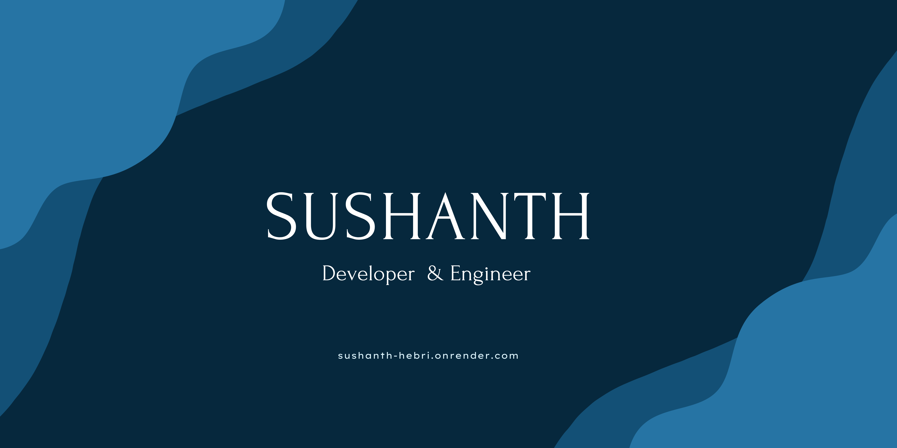

  

# Sushanth Hebri

Software engineer. I build things and solve problems, and my strongest suit is user experience and interface: how a product feels to use, and the engineering that makes it work.

[Portfolio](https://sushanth-hebri.onrender.com/) · [LinkedIn](https://linkedin.com/in/sushanth_hebri) · [CodePen](https://codepen.io/sushanth-hebri) · [X](https://twitter.com/sushanth_hebri) · [LeetCode](https://www.leetcode.com/sushanth_hebri) · [Email](mailto:sushanthhebri336@gmail.com)

---

## Publication

[Blindaid: Assisting the Visually Impaired in Object Detection and Tracking Using SLAM](https://theaspd.com/index.php/ijes/article/view/323)
*International Journal of Engineering & Science, 2024. Recognized as a Top 3 Project in 2025.* [Abstract](https://github.com/Sushanth-Hebri/Compass3.1/wiki/Paper-Abstract)

---

## Latest: Rhombus

Rhombus turns a song into a living crystal that moves with the beat. Search for a track or play your own audio, and the colours, lyrics and visuals follow the music.

**[Open Rhombus](https://sushanth-hebri.github.io/Rhombus-vizualizer/)**

---

## Selected work

<table>
  <tr>
    <td width="50%" valign="top">
      
       <b><a href="https://sushanth-hebri.github.io/vellfire-experience/">Vellfire experience</a></b>
       An immersive web experience.
    </td>
    <td width="50%" valign="top">
      
       <b><a href="https://sushanth-hebri.github.io/The-Film-Oracle/">The Film Oracle</a></b> (<a href="https://github.com/Sushanth-Hebri/The-Film-Oracle">code</a>)
       A film-themed interface.
    </td>
  </tr>
  <tr>
    <td width="50%" valign="top">
      
       <b><a href="https://sushanth-hebri.github.io/The-Space-Between-Words/">The Space Between Words</a></b>
       Music and typography, told as a story.
    </td>
    <td width="50%" valign="top">
      
       <b><a href="https://github.com/Sushanth-Hebri/GeoDash-Fleet_Management">GeoDash</a></b>
       A fleet management console.
    </td>
  </tr>
</table>

More screenshots

 

---

## All projects

**Music and visuals**

- [Rhombus](https://sushanth-hebri.github.io/Rhombus-vizualizer/): song visualizer with search, lyrics and your own audio
- [Visualize Songs Now](https://sushanth-hebri.github.io/Visualize-songs/): song visualization with interactive controls
- [Viz Music](https://sushanth-hebri.github.io/Viz-Music/): music search and playback
- [The Space Between Words](https://sushanth-hebri.github.io/The-Space-Between-Words/): music and typography concept
- [Vellfire experience](https://sushanth-hebri.github.io/vellfire-experience/)

**Film**

- [The Film Oracle](https://sushanth-hebri.github.io/The-Film-Oracle/)
- [TMDB Movie Explorer](https://sushanth-hebri.github.io/TMDB-API-INTEGRATION/): browse recent movies using the TMDB API

**Apps and platforms**

- [GeoDash](https://github.com/Sushanth-Hebri/GeoDash-Fleet_Management): fleet management console
- [Mind-Chit](https://mind-chit.vercel.app): content-sharing app built with React
- [Rounds](https://rounds.onrender.com/): interactive storytelling site
- [Group Talks](https://grouptalkk.onrender.com): real-time group chat
- [MERN auth](https://sushanth-auth.onrender.com/sign-in/): full-stack MERN sign-in system
- [Green Estate](https://sushanth-hebri.github.io/Green-Estate_A_Real_Estate_Platform/): real estate platform demonstrating the Green Vision API
- [Space Cards](https://github.com/Sushanth-Hebri/Spacecard-App-Versions-CP): space-themed card app, several versions

**Tools**

- [Human Image Verifier](https://hebris-human-validations.onrender.com/): human image verification
- [Hebri's Assistant](https://sushanth-hebri.github.io/Hebri-s-Assistant---accumulated-tools-/): a collection of small utilities

---

## Stack

  
  
  
  
  
  
  
  
  
  
  

  
  

---

Ask me about HTML, CSS, JavaScript, prototypes, frontend design or backend setups: [sushanthhebri336@gmail.com](mailto:sushanthhebri336@gmail.com)
